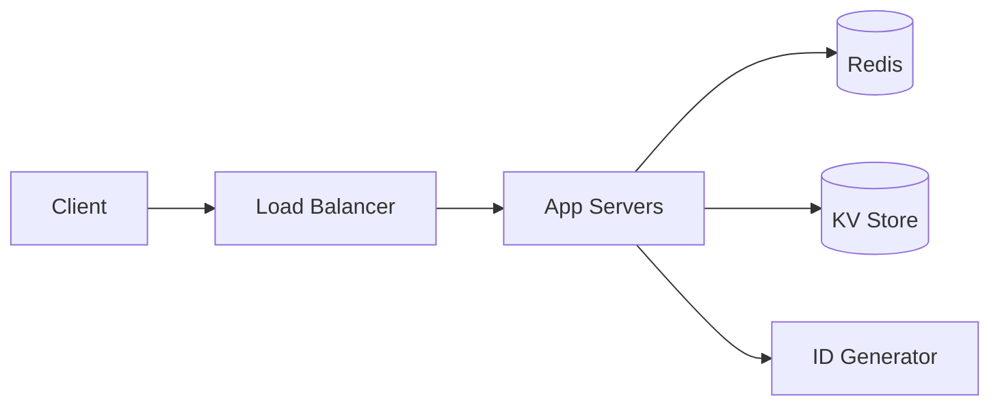

## Requirements

- Create short link from long URL; redirect short -> long.
- 100M new URLs/month, 100:1 read:write.
- Redirect latency < 50 ms p99.

## High-level design



## Key decisions

| Decision | Choice | Why |
|---|---|---|
| ID generation | Base62 of counter | No collisions, short |
| Storage | KV store | Simple lookups by key |
| Redirect | 302 | Allows analytics |

## Code sketch

```python
ALPHABET = "0123456789abcdefghijklmnopqrstuvwxyzABCDEFGHIJKLMNOPQRSTUVWXYZ"

def encode(n: int) -> str:
    s = ""
    while n:
        n, r = divmod(n, 62)
        s = ALPHABET[r] + s
    return s or "0"
```
